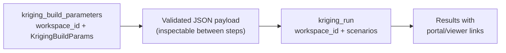

# Compute tools — `tools/compute_tools.py`

## Shared behavior

All compute tools use the same build → inspect → run flow:

- Set `neighborhood.ellipsoid` (`search` is also accepted as an input alias) with
  `ellipsoid_ranges` (or `ranges`) and optional `rotation` (`dip_azimuth`, `dip`,
  and `pitch`). Build output emits canonical `neighborhood`, `ellipsoid_ranges`,
  and `rotation`, and run tools preserve them for Evo.
- Unknown or misplaced fields are rejected at every nesting level instead of
  being silently ignored, so typos cannot fall back to defaults.
- Run tools re-check build-time limits on the submitted payloads.
- Builders resolve filter attribute names against the source or target object,
  including nested `all_of` and `any_of` conditions. Existing SDK attribute
  expressions pass through unchanged. Edited run payloads must use expressions,
  not bare attribute names.
- `max_samples` must be positive; `min_samples`, when set, must be between one
  and `max_samples`. Drillhole neighborhood limits require a `DownholeIntervals`
  source object.
- Every referenced object must belong to the `workspace_id` passed to the run
  tool, on the same hub and instance.
- Scenarios in one run call must write to distinct outputs: distinct target
  attributes (resolving update selectors to canonical target attributes) for
  kriging, IDW, and KNN; distinct target grids for ConSim.

## Inverse distance weighting (IDW)

Use `idw_build_parameters(workspace_id, params)` followed by
`idw_run(workspace_id, scenarios)`. The builder resolves a published source
object (such as a `PointSet` or `DownholeIntervals`) and an existing target
object. It returns inspectable JSON without executing estimation.

Parameters are `point_set_object_id`, an existing numeric `point_set_attribute`,
`target_object_id`, `target_attribute`, and `neighborhood` (or `search`:
ellipsoid and sample/sector/drillhole limits; `min_drillholes` and non-global
`drillhole_limit_scope` are kriging-only). Optional source and target filters
restrict the input samples and output locations. `power` is a finite positive
distance-weighting exponent, defaulting to `2.0`. Distances are measured in the
anisotropic space defined by the search ellipsoid. No variogram or kriging
method is required.

The runner submits scenarios concurrently, reports progress, and returns target
attribute references plus portal/viewer links in input order. Estimates create
or update attributes on published target objects; this is not a dry run. Use
distinct output attribute names when comparing scenarios.

## K-nearest neighbors (KNN)

Use `knn_build_parameters(workspace_id, params)` followed by
`knn_run(workspace_id, scenarios)`. Inputs are the same source, target,
`neighborhood` (or `search`), and optional filters as IDW, without `power` or a
variogram.

Evo KNN computes the arithmetic mean of accepted neighbors, with equal weights.
Set `neighborhood.max_samples` (or `search.max_samples`) to the maximum neighbor
count; this is not a separate `k` parameter. Search constraints and sample
availability can reduce that count. For both IDW and KNN, `max_samples` must be
positive and `min_samples`, when set, must be between one and `max_samples`.

The runner reports progress and returns created/updated attribute references
and links in scenario order. Use distinct output attributes for comparisons.

## Conditional simulation (ConSim)

Use `consim_build_parameters(workspace_id, params)` followed by
`consim_run(workspace_id, scenarios)`. This wraps the SDK's high-level `consim`
task: Evo handles normal-score transformation, conditioning kriging,
turning-bands simulation, back-transformation, and requested statistics/reporting.
MCP does not implement the numerical algorithms or download all realizations.

Required inputs are `point_set_object_id`, an existing numeric
`point_set_attribute`, `target_object_id`, `variogram_object_id`, and
`neighborhood` (or `search`). The source must be a published PointSet, the
target a Regular3DGrid or RegularMasked3DGrid, and the variogram a published
Variogram. Local staged edits must be published first. Use a variogram
compatible with the simulation's normal-score modelling workflow; schema
validation does not establish scientific suitability.

Controls include:

- `number_of_simulations`: 1-100, default 1.
- `number_of_simulations_to_save`: 0 through the generated count, default 1.
  Zero publishes summary statistics without saving the realization ensemble;
  it cannot be combined with `perform_validation=true`.
- `number_of_lines`: 1-1000, default 500.
- `random_seed`: default 38239342, passed through for reproducibility.
- `kriging_method`: `simple` (default) or `ordinary` for conditioning.
- `block_discretization`: `nx`, `ny`, `nz`; defaults to one in each direction.
- `source_filter` and `target_filter`: optional domain/sample restrictions.
- `distribution`: optional `weights_attribute`, an existing numeric source
    attribute such as declustering weights, and `tail_extrapolation` settings.
- `location_wise_quantiles`: optional quantiles in [0, 1].
- `probability_above_cutoff` and `mean_above_cutoff`: optional finite cutoffs.
- `perform_validation`: optional validation, default false. `report_context`
  and `report_mean_thresholds` require this to be true. At least one realization
  must be saved when validation is enabled.

The SDK does not accept octant, quadrant, or drillhole search limits for ConSim.
The builder does not expose a single `target_attribute`: simulation creates
multiple output attributes. Economic loss-calculation configuration is not
exposed by this builder.

Results contain the target locator, mean/variance/min/max attribute references,
the saved ensemble reference when requested, optional quantile/cutoff references,
validation summary/report reference, and portal/viewer/dashboard links. The
validation-report reference is read from the stored result model because
`ConSimResult` does not yet expose a public report property.

The runner waits for completion and forwards progress. Concurrent ConSim
scenarios must use distinct target objects to avoid conflicting output writes.
These are real compute jobs, not dry runs: grid size, simulation count, line
count, and discretization affect runtime and storage. Validate simulation
statistics and conditioning against representative data before production use.

## Kriging

Kriging is deliberately **two steps** so the LLM (or user) can inspect and adjust
configuration before execution.



---

## `kriging_build_parameters`

Resolves source, target, and variogram from Evo (parallel), validates inputs,
and produces a round-trippable `KrigingParameters` JSON payload:

```
point_set_object_id + point_set_attribute
variogram_object_id
target_object_id    + target_attribute
neighborhood (ellipsoid + sample/sector/drillhole limits; alias: search)
kriging_method (ordinary | simple; alias: method)
source_filter, target_filter, block_discretization (optional)
```

### Parameter details

- **Canonical names & aliases**: `neighborhood` and `kriging_method` are canonical
  and emitted in built payloads (`search` and `method` remain accepted as input
  aliases unless conflicting values are supplied for both).
- **Ellipsoid**: `neighborhood.ellipsoid` accepts `ellipsoid_ranges` (or `ranges`)
  with positive `major`, `semi_major`, and `minor`, plus `rotation` (`dip_azimuth`,
  `dip`, `pitch`), and serializes `ellipsoid_ranges` and `rotation`.
- **Sample & sector limits**: `max_samples` (`>= 1`), optional `min_samples`
  (`1..max_samples`), and optional octant/quadrant limits (`max_empty_octants`,
  `max_samples_per_octant`, `max_empty_quadrants`, `max_samples_per_quadrant`).
- **Drillhole limits** (require a `DownholeIntervals` source object):
  - `max_samples_per_drillhole` (`>= 1`)
  - `max_drillholes` (`>= 1`; input alias: `max_drillholes_per_estimate`)
  - `min_drillholes` (`>= 0`, omitted when `None` or `0`; input alias:
    `min_drillholes_per_estimate`)
  - `drillhole_limit_scope` (`"global"`, `"quadrant"`, or `"octant"`; omitted
    when `None` or `"global"`, and requires `max_samples_per_drillhole` when
    `"quadrant"` or `"octant"`)
- **Source validation**: `point_set_object_id` supports `PointSet`,
  `DownholeIntervals`, and other point-like spatial objects. Setting any active
  drillhole limit (`max_samples_per_drillhole`, `max_drillholes`,
  `min_drillholes > 0`, or non-global `drillhole_limit_scope`) on a
  non-`DownholeIntervals` source fails fast at build time with a `ValueError`.
- **Strictness**: Unknown fields are rejected at every nesting level.

---

## `kriging_run`

Accepts one or more `KrigingParameters` payloads and runs them in parallel.
Progress is bridged from the SDK's `IFeedback` → FastMCP `ctx.report_progress()`.

Returns per-scenario: target name, attribute created/updated, portal + viewer links.

---

## Why two steps?

- LLM can summarize inputs to the user for confirmation before execution
- Multi-scenario runs: build N payloads, review, then run in one batch
- Separates Evo object resolution (build) from compute submission (run)
