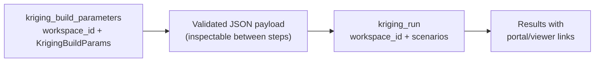

# Compute tools — `tools/compute_tools.py`

## Shared behavior

All compute tools use the same build → inspect → run flow:

- Set `search.ellipsoid.rotation` with `dip_azimuth`, `dip`, and `pitch`. The
  SDK's internal `_rotation` name is also accepted, but not both. Build output
  keeps `rotation`, and run tools preserve it for Evo.
- Unknown or misplaced fields are rejected at every nesting level instead of
  being silently ignored, so typos cannot fall back to defaults.
- Run tools re-check build-time limits on the submitted payloads.
- Builders resolve filter attribute names against the source or target object,
  including nested `all_of` and `any_of` conditions. Existing SDK attribute
  expressions pass through unchanged. Edited run payloads must use expressions,
  not bare attribute names.
- `max_samples` must be positive; `min_samples`, when set, must be between one
  and `max_samples`.
- Every referenced object must belong to the `workspace_id` passed to the run
  tool, on the same hub and instance.
- Scenarios in one run call must write to distinct outputs: distinct target
  attributes for kriging, IDW, and KNN.

## Inverse distance weighting (IDW)

Use `idw_build_parameters(workspace_id, params)` followed by
`idw_run(workspace_id, scenarios)`. The builder resolves a published source
point set and an existing target object. It returns inspectable JSON without
executing estimation.

Parameters are `point_set_object_id`, an existing numeric `point_set_attribute`,
`target_object_id`, `target_attribute`, and `search` (ellipsoid and sample limits).
Optional source and target filters restrict the input samples and output locations.
`power` is a finite positive distance-weighting exponent, defaulting to `2.0`.
Distances are measured in the anisotropic space defined by the search ellipsoid.
No variogram or kriging method is required.

The runner submits scenarios concurrently, reports progress, and returns target
attribute references plus portal/viewer links in input order. Estimates create
or update attributes on published target objects; this is not a dry run. Use
distinct output attribute names when comparing scenarios.

## K-nearest neighbors (KNN)

Use `knn_build_parameters(workspace_id, params)` followed by
`knn_run(workspace_id, scenarios)`. Inputs are the same source, target, `search`,
and optional filters as IDW, without `power` or a variogram.

Evo KNN computes the arithmetic mean of accepted neighbors, with equal weights.
Set `search.max_samples` to the maximum neighbor count; this is not a separate
`k` parameter. Search constraints and sample availability can reduce that count.
For both IDW and KNN, `max_samples` must be positive and `min_samples`, when set,
must be between one and `max_samples`.

The runner reports progress and returns created/updated attribute references
and links in scenario order. Use distinct output attributes for comparisons.

## Kriging

Kriging is deliberately **two steps** so the LLM (or user) can inspect and adjust
configuration before execution.



---

## `kriging_build_parameters`

Resolves source, target, and variogram from Evo (parallel), then produces a
validated `KrigingParameters` JSON payload:

```
point_set_object_id + point_set_attribute
variogram_object_id
target_object_id   + target_attribute
search (ellipsoid + sample counts)
method (ordinary | simple)
region filter, block discretisation (optional)
```

---

## `kriging_run`

Accepts one or more `KrigingParameters` payloads and runs them in parallel.
Progress is bridged from the SDK's `IFeedback` → FastMCP `ctx.report_progress()`.

Returns per-scenario: target name, attribute created/updated, portal + viewer links.

---

## Why two steps?

- LLM can summarize inputs to the user for confirmation before execution
- Multi-scenario runs: build N payloads, review, then run in one batch
- Separates Evo object resolution (build) from compute submission (run)
